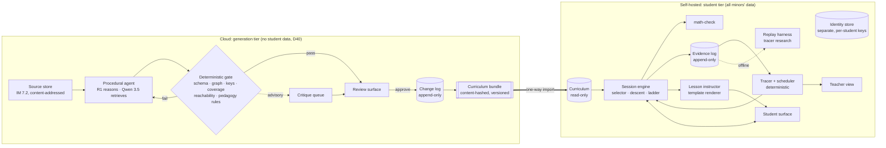

# Architecture — MindyourTutor MVP

Status: draft for review
Authority: `CANON.md` (where this disagrees, the Canon wins)
Scope: `PROJECT_BRIEF.md` §3–4

---

## 1. Shape

There are two tiers and one crossing between them, and the crossing goes one way only.

**The one rule the shape enforces:** the student tier never calls the cloud tier, and nothing leaves the student tier. The only thing that crosses is an approved, hashed bundle, going inward. The cloud tier therefore cannot see minors' data by construction (D40), not by policy.

---

## 2. Components by layer

| Layer | Component | Where | Decides or proposes | Canon |
|---|---|---|---|---|
| **M1** | `math-check`: equivalence, `unparseable` ≠ `incorrect`, typo rejection | Library, both tiers, pinned version | Decides | I1, D19 |
| **M1** | Schemas, append-only store, `rebuild()` | Both tiers | Decides | I2, D34 |
| **M1** | Graph validation: structural DAG, associative edges unroutable | Library | Decides | D12 |
| **M1** | Template + key validation | Library | Decides | I7, D17 |
| **M2** | Seed benchmark (`D_val` seed) | Repo, read-only to agents | Ground truth | I4, D24 |
| **M3** | Procedural agent: extract → objectives → KCs → edges → items → materials | Cloud | Proposes | D16, D20 |
| **M3** | Review surface and approval gate | Cloud | A human decides | D16, D38 |
| **M4** | Evaluator gate (deterministic) and critique (advisory) | Cloud, code from repo | Gate decides; critique proposes | D23, D28 |
| **M4** | Lesson instructor: parameterised templates | Student tier | Renders only | D29, D31 |
| **M5** | Evidence capture | Student tier | Records | I8, D34 |
| **M5** | Tracer + scheduler | Student tier | Decides | I3, D6 |
| **M6** | Student surface, teacher view, identity, tenancy, retention | Student tier | — | I9, I10, D10 |

**Where ground truth lives (I4).** `math-check`, the gate and the benchmark are code and data in this repo. Agents run against a pinned version and have no write path to them. A change to any of them is a reviewed commit, never an agent output.

---

## 3. Generation tier (cloud)

**Stages.** Each stage is a folder in the agent registry (task 3.5): prompt, output schema and content hash, stamped on every run.

| Stage | Model role | Output | Gate checks |
|---|---|---|---|
| Extract & segment | Qwen 3.5 via RAG over sources | Segments with source spans | Schema; span recoverable (task 3.4) |
| Objectives | R1 | Objectives per lesson | Schema; coverage of CCSS-M annotations |
| KC candidates | R1 | KCs with rationale string | Schema; each objective covered |
| Edges | R1, with retrieved spans | Claim-typed edges | Dependency claims pass span containment, or are demoted to `document-order` (D20); DAG; reachability |
| Item templates | R1 | Parameterised templates at three load levels | Key verified by `math-check` across sampled instantiations; three load levels per KC (D28) |
| Materials | R1 | Worked examples, ladder steps, framings | `math-check` on every mathematical assertion (D19); worked example before independent practice (D28) |

**Retrieval (RAG).** The store is an index over the content-addressed IM source only. Retrieved spans serve two purposes: they ground generation, and they are the verbatim evidence a `dependency-claim` must contain (D20). **No graph goes into a prompt** (I5). A stage receives source spans and at most one node's rationale.

**Review surface.** A queue per stage. It shows the artifact, its source spans, gate results and critique notes, plus a rendered KC graph for the reviewer (the "display the schema" requirement in `QA_Testing_Criteria.md`). Approve, edit or reject writes to the change log. Time per artifact is logged so review load can be measured (PROJECT_BRIEF §5).

**Export.** The approved state is materialised from the change log into a bundle: KCs, edges, objectives, templates, materials, provenance and CCSS-M annotations, with a manifest hash. A bundle is immutable. A new approval produces a new bundle version.

---

## 4. Student tier (self-hosted)

**No model at runtime.** Every word the student sees comes from an approved template, filled with parameters by code. This follows from:

- D31: about 4 tok/s cannot serve a live session.
- I3: selection, adjudication and scheduling are code.
- I6: when uncertain, inject nothing.

It also makes each session exactly replayable and keeps the safeguarding surface small. The STUDENT_EXPERIENCE dialogue ("Not quite — check the sign", "That's on the explanation, not on you") is a small set of approved lines keyed to situations, not generated prose. Adding live generation later means revisiting D31, not quietly adding a model call.

**Session engine.** This is deterministic, and its rules are data from the bundle plus constants in code:

1. **Open:** retrieval items due today come first ("two quick ones"), then the assigned or requested KC.
2. **Adjudicate:** `math-check` → `correct` | `incorrect` | `unparseable`. An `unparseable` answer re-prompts with what was understood, and it is never scored (I1).
3. **Escalate:** the ladder advances on evidence of unproductive struggle (for example, two incorrect answers on the same KC, or a time threshold), not on request (D3). Thresholds are named constants that cite D3.
4. **Descend:** on failure attributed below the current KC, move one structural edge down and tell the student why (D4). Stop at the bound: name the gap, give a reduced-load item, flag the teacher (D5).
5. **Close:** end on an unassisted success, or immediately when the student stops, with no "are you sure?" (D9).

**Evidence event.** A typed core plus an open attribute bag. Following D34, most core columns are nullable because the second use case has no item.

| Field | Notes |
|---|---|
| `event_id`, `student_ref`, `session_id`, `ts`, `type` | Always present |
| `item_instance_id`, `kc_id`, `template_version`, `load_level` | Null for declined offers, abandons, ignored pings, descents with no attempt |
| `raw_input`, `adjudication`, `latency_ms`, `scaffold_level` | Present when there was a response |
| `shown` | What was displayed, including the surface variant (D18) |
| `attrs` | Registered extensible signals: pause before first keystroke, edits, hover on an option, and so on. The attribute registry is itself append-only. |

**Tracer and scheduler (baseline, task 4.2).** A pure function from the evidence log to state. Nothing is stored that can be recomputed (I8).

- *Acquisition* per KC: acquired after N unassisted correct answers across at least 2 surface forms.
- *Retrievability* per KC is kept separate from acquisition (D6). Retrieval is due on an expanding schedule. A failed retrieval returns the KC to acquisition, and assisted attempts never count as retrieval.
- N and the intervals are placeholders, to be fixed from the benchmark and synthetic learners.
- The interface is `trace(events) -> state` and `schedule(state, now) -> due`. The Q4 tracer replaces this implementation without changing callers. Thinking-KT-style LLM methods run only in the offline replay harness, for comparison (D39).

**Teacher view.** Per student: KCs acquired and due, gaps named at descent stops, and escalations. It is written in sentences, and nothing from it reaches the student (D10).

**Data protection.**

- The identity store is a separate database. The evidence log carries only an opaque `student_ref`.
- Each student has their own encryption key, so erasure is key destruction (tasks 5.2, 5.3).
- `tenant_id` and row-level security are enabled from day one, even with one tenant (task 5.1).
- The disclosure sentence is shown once at entry (I9).
- The escalation path goes to the teacher (I10).

---

## 5. What makes the architecture fail, and the guard against each

| Failure | Guard |
|---|---|
| Student data leaks to the cloud tier | No outbound path from the student tier. The import is a file. |
| Something reaches a student without approval | The student tier reads only bundles, and a bundle is built only from the change log. |
| An agent edits its own ruler | Gate, `math-check` and benchmark live in the repo, pinned, with no agent write path (I4). |
| Review becomes a rubber stamp | Review time per artifact is measured. Generation is throttled to the reviewer's capacity. |
| The tracer is wrong silently | Replay harness; delayed-retention prediction is the headline metric (task 4.4). |
| A session can't be reconstructed | Append-only evidence log, and no model in the student path. |

---

## 6. Proposed stack

| Concern | Choice | Reason |
|---|---|---|
| Language | Python ≥ 3.11 | Already set in `pyproject.toml`. SymPy is the natural base for `math-check`. |
| Database | PostgreSQL | Triggers for append-only tables, row-level security, JSONB for `attrs` |
| Symbolic checking | SymPy behind our own parser and typo gate | `unparseable` must be ours to return, not an exception |
| Student-tier web | Server-rendered pages with minimal JS | Fast first screen on low-end devices (D2); one problem, no chrome |
| Generation-tier models | DeepSeek R1 and Qwen 3.5 via the cloud provider | D40. Variant and budget are still open (Q3). |
| Packaging | `authoring` (generation tier + gate), `tutor` (student tier), `mathcheck` (shared) | The dependency direction enforces the one-way crossing: `tutor` never imports `authoring`. |
