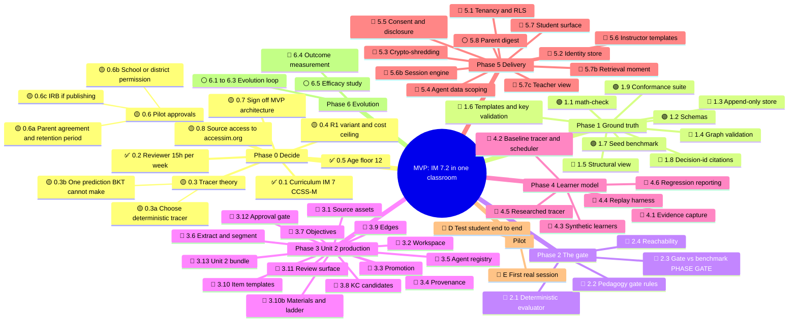
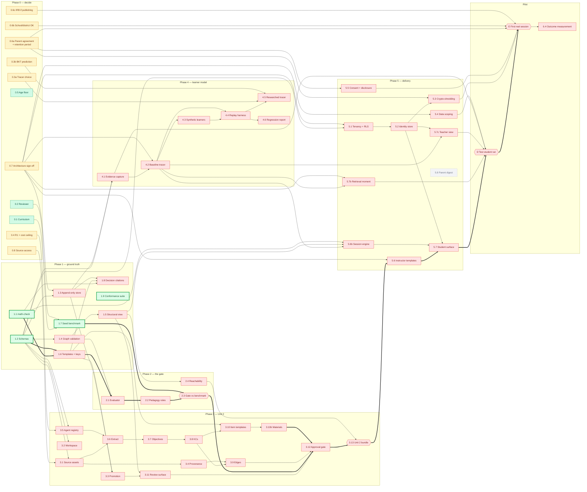

# Task graph — the build map

Status: live. **The reference for what can be worked on next.**
Authority: `CANON.md` → `TASKS.md` (what each task is) → this file (status, dependencies, blockers)
Scope: the MVP in `PROJECT_BRIEF.md`

This is the work graph for building the product. It is **not** the D21 procedural graph, which is the procedural agent's memory.

---

## How to use it

1. **Only start a node whose status is 🟢.** A node is ready when every node in its `Needs` column is ✅.
2. **The node table (§3) is authoritative.** The two diagrams are views of it. Any change to a status or dependency updates the table and both diagrams in the same commit.
3. **Finishing a node:** mark it ✅, then re-check every node that lists it in `Needs` and promote any that are now 🟢.
4. **A new blocker** gets a node of its own, not a note. If it can't be drawn, nobody will see it's in the way.

| Mark | Meaning |
|---|---|
| ✅ | Done |
| 🟢 | Ready: every dependency is done |
| 🟡 | A decision or action that only the project lead can take |
| 🔴 | Blocked: waiting on the nodes in `Needs` |
| ⚪ | Deferred: outside the MVP |

---

## 1. Mind map

---

## 2. Dependency graph

An arrow `A --> B` means B needs A. The thick path is the critical path to the first real session.

---

## 3. Node table (authoritative)

`Needs` lists the hard dependencies. **Owner** says who moves the node: *Lead* is the project lead, *Claude* is the coding agent, *External* is someone outside the project.

### Phase 0 — decide

| Node | Status | Needs | Owner | Unblocks | Notes |
|---|---|---|---|---|---|
| 0.1 Curriculum | ✅ | — | Lead | 3.1, 1.7 | D37 |
| 0.2 Reviewer | ✅ | — | Lead | 1.7, 3.11 | D38 |
| 0.3a Choose deterministic tracer | 🟡 | — | Lead | 4.5 | D39. Doesn't block the MVP: the baseline tracer (4.2) runs the pilot |
| 0.3b One prediction BKT can't make | 🟡 | — | Lead | 4.5 | Candidates are listed in `TASKS.md` §Phase 0 |
| 0.4 R1 variant + cost ceiling | 🟡 | — | Lead | 3.5 → all generation | D40 |
| 0.5 Age floor | ✅ | — | Lead | 0.6a, 5.5 | D41 |
| 0.6a Parent agreement + retention period | 🟡 | — | Lead | 5.3, 5.5, E | Must carry the I9 disclosure sentence |
| 0.6b School/district permission + data-privacy agreement | 🟡 | — | Lead, External | E | |
| 0.6c IRB approval, if results will be published | 🟡 | — | Lead, External (USC) | E | Not needed if nothing is published |
| 0.7 Sign off MVP architecture | 🟡 | — | Lead | 1.3, 4.2, 5.1, 5.4, 5.6, 5.7b | `PROJECT_BRIEF.md` §7 and `ARCHITECTURE.md`: no live LLM for students, no open chat, one-way bundle, retrieval channel, Postgres stack |
| 0.8 Source access to IM 7.2 | 🟡 | — | Lead | 3.1 | accessim.org is blocked by this environment's network policy. Either allow the domain or commit the source files |

### Phase 1 — ground truth (no models)

| Node | Status | Needs | Owner | Unblocks | Notes |
|---|---|---|---|---|---|
| 1.1 `math-check` | 🟢 | — | Claude | 1.6, 1.8, 5.6b | Unit 2 input forms: numbers, fractions, `y = kx`, table cells |
| 1.2 Schemas | 🟢 | — | Claude | 1.3, 1.4, 1.6, 3.1, 3.2, 3.5, 4.1, 5.1 | D34: design for the second use case |
| 1.3 Append-only store, change log, `rebuild()` | 🔴 | 1.2, 0.7 | Claude | 1.8, 3.3, 4.1 | Postgres triggers need the stack signed off |
| 1.4 Graph validation engine | 🔴 | 1.2 | Claude | 1.5, 2.1 | |
| 1.5 Structural view | 🔴 | 1.4 | Claude | 2.4, 3.11, 5.6b | |
| 1.6 Templates + key validation | 🔴 | 1.1, 1.2 | Claude | 2.1, 3.3, 3.10 | Critical path |
| 1.7 Seed benchmark, 20–30 artifacts, 3 spoiled | 🟢 | 0.1, 0.2 | Lead (Claude drafts formats) | 2.3 | Critical path. Unit 2 artifacts |
| 1.8 Decision-id citations | 🔴 | 1.1, 1.3, 1.6 | Claude | — | Ongoing, starting with the first test |
| 1.9 Conformance suite from the Canon | 🟢 | — | Claude | — | D33: write it before the implementation exists |

### Phase 2 — the gate

| Node | Status | Needs | Owner | Unblocks | Notes |
|---|---|---|---|---|---|
| 2.1 Deterministic evaluator | 🔴 | 1.4, 1.6 | Claude | 2.2 | |
| 2.2 Pedagogy principles as gate rules | 🔴 | 2.1 | Claude | 2.3 | D28 |
| **2.3 Gate scored against benchmark** | 🔴 | 2.2, 1.7 | Claude + Lead | 3.12 | **Phase gate.** Must catch every planted defect |
| 2.4 Reachability check | 🔴 | 1.5 | Claude | 3.13 | |

### Phase 3 — Unit 2 production (cloud)

| Node | Status | Needs | Owner | Unblocks | Notes |
|---|---|---|---|---|---|
| 3.1 Source assets | 🔴 | 1.2, 0.8 | Claude | 3.4, 3.6 | |
| 3.2 Workspace | 🔴 | 1.2 | Claude | — | |
| 3.3 Promotion | 🔴 | 1.3, 1.6 | Claude | 3.11 | |
| 3.4 Provenance | 🔴 | 3.1 | Claude | 3.9 | |
| 3.5 Agent registry | 🔴 | 1.2, 0.4 | Claude | 3.6 | |
| 3.6 Extract & segment | 🔴 | 3.1, 3.5 | Claude | 3.7 | Qwen 3.5 RAG |
| 3.7 Objectives | 🔴 | 3.6 | Claude → Lead reviews | 3.8 | |
| 3.8 KC candidates | 🔴 | 3.7 | Claude → Lead reviews | 3.9, 3.10 | Includes one level of Grade 6 prerequisites |
| 3.9 Edges (claim-typed) | 🔴 | 3.8, 3.4 | Claude → Lead reviews | 3.12 | D20 |
| 3.10 Item templates, 3 load levels | 🔴 | 3.8, 1.6 | Claude → Lead reviews | 3.10b | |
| 3.10b Materials + scaffolding ladder | 🔴 | 3.10 | Claude → Lead reviews | 3.12 | D3, D19 |
| 3.11 Review surface | 🔴 | 3.3, 1.5 | Claude | 3.12 | Shows the KC graph to the reviewer |
| 3.12 Human approval gate | 🔴 | 3.11, 2.3, 3.9, 3.10b | Lead | 3.13 | Critical path |
| **3.13 Unit 2 bundle exported** | 🔴 | 3.12, 2.4 | Claude + Lead | 5.6 | **Milestone C** |

### Phase 4 — learner model (self-hosted)

| Node | Status | Needs | Owner | Unblocks | Notes |
|---|---|---|---|---|---|
| 4.1 Evidence capture | 🔴 | 1.2, 1.3 | Claude | 4.2, D | Includes the `QA_Testing_Criteria.md` signals |
| 4.2 Tracer interface + baseline + scheduler | 🔴 | 4.1, 0.7 | Claude | 4.3, 4.4, 5.6b, 5.7b, 5.7c | Runs the pilot. Its thresholds are placeholders |
| 4.3 Synthetic learners | 🔴 | 4.2 | Claude | 4.4 | |
| 4.4 Replay harness | 🔴 | 4.2, 4.3 | Claude | 4.5, 4.6 | Headline metric: delayed retention |
| 4.5 Researched tracer | 🔴 | 4.4, 0.3a, 0.3b | Lead + Claude | — | Not on the pilot's critical path |
| 4.6 Regression reporting | 🔴 | 4.4 | Claude | — | |

### Phase 5 — delivery (self-hosted)

| Node | Status | Needs | Owner | Unblocks | Notes |
|---|---|---|---|---|---|
| 5.1 Tenancy + RLS | 🔴 | 1.2, 0.7 | Claude | 5.2 | One tenant, built properly |
| 5.2 Identity store | 🔴 | 5.1 | Claude | 5.3, 5.7, 5.7c | |
| 5.3 Crypto-shredding erasure | 🔴 | 5.2, 0.6a | Claude | E | The retention period comes from 0.6a |
| 5.4 Agent data scoping | 🔴 | 0.7 | Claude | D | Small scope if there's no model in the student path |
| 5.5 Consent artifacts + disclosure | 🔴 | 0.6a | Lead + Claude | E | |
| 5.6 Instructor: approved template renderer | 🔴 | 3.13, 0.7 | Claude | 5.7 | Critical path |
| 5.6b Session engine: selector, descent, ladder | 🔴 | 4.2, 1.5, 1.1 | Claude | 5.7 | |
| 5.7 Student surface | 🔴 | 5.6, 5.6b, 5.2 | Claude | D | |
| 5.7b Retrieval moment | 🔴 | 4.2, 0.7 | Claude | D | The channel choice is part of 0.7 |
| 5.7c Teacher view | 🔴 | 4.2, 5.2 | Claude | D | |
| 5.8 Parent digest | ⚪ | — | — | — | Outside the MVP |

### Pilot and after

| Node | Status | Needs | Owner | Unblocks | Notes |
|---|---|---|---|---|---|
| **D Test student end to end** | 🔴 | 5.7, 5.7b, 5.7c, 4.1, 5.4 | Claude + Lead | E | **Milestone D.** Descent and retrieval, replayable |
| **E First real session** | 🔴 | D, 5.3, 5.5, 0.6a, 0.6b, 0.6c | Lead | 6.4 | **Milestone E** |
| 6.1–6.3 Evolution loop | ⚪ | — | — | — | D26: off until `D_val` exists |
| 6.4 Outcome measurement | 🔴 | E | Lead + Claude | — | Retention, transfer, prerequisite repair |
| 6.5 Efficacy study | ⚪ | — | — | — | Not the MVP |

---

## 4. Right now

**Ready for Claude:** 1.1 `math-check`, 1.2 schemas, 1.9 conformance suite.

**Ready for the lead:** 1.7 seed benchmark, and the decisions 0.7 → 0.8 → 0.4 → 0.6a, in order of how much they unblock.

| Lead action | Blocks this many downstream nodes |
|---|---|
| 0.7 Architecture sign-off | 1.3, 4.2, 5.1, 5.4, 5.6, 5.7b, and through them nearly all of Phases 4–5 |
| 0.4 R1 + cost ceiling | 3.5 → the whole Phase 3 generation chain |
| 0.8 Source access | 3.1 → the whole Phase 3 generation chain |
| 0.6a Parent agreement | 5.3, 5.5, E |
| 0.6b / 0.6c Approvals | E only, but these can take the longest, so start early |

**Critical path to the first real session:**
1.1 + 1.2 → 1.6 → 2.1 → 2.2 → 2.3 (with 1.7) → 3.12 → 3.13 → 5.6 → 5.7 → D → E
