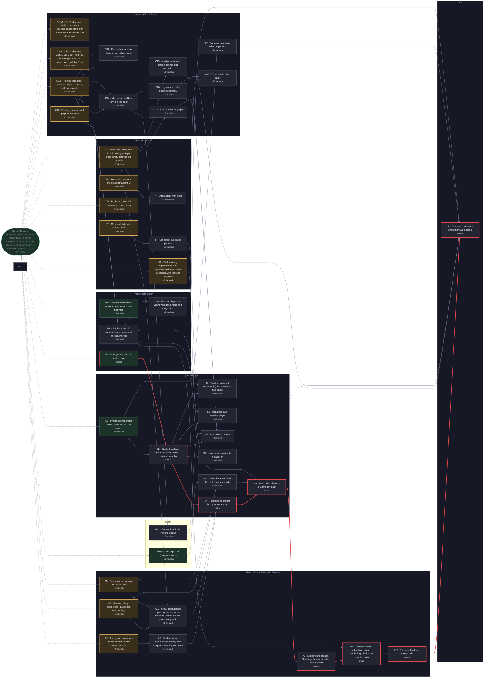

# Plan

<!-- Generated by `node scripts/plan.mjs` from docs/tasks.json. Do not edit by hand. -->

**38 of 108 done** · 6 ready · 0 in progress · 12 in review · 34 blocked · 18 need a spec

Critical path to the v0.1 pilot: F1 → F3 → C3 → C8 → C2cx5 → C4 → C5 → S10 → S10b → M4 → S2 → S4 → S4t → A9 → M6 → A10 → L1 (up to 30 weeks)

## Versions

Goals and scope are in [ROADMAP.md](ROADMAP.md) (D45). Progress is weighted by task size.

| Version | Focus | Done | Built | In review | In progress | Ready | Need a spec | Milestone |
|---|---|---|---|---|---|---|---|---|
| v0.1 | Pilot (MVP) | 38 of 81 | 43% | 12 | 0 | 4 | 1 | L1 |
| v0.2 | AI design principles | 0 of 12 | 0% | 0 | 0 | 0 | 8 | — |
| v0.3 | Visuals and motivation | 0 of 8 | 0% | 0 | 0 | 0 | 7 | — |
| v0.4 | Curriculum building | 0 of 7 | 0% | 0 | 0 | 2 | 2 | — |

## Ready to start

Pick from here. Claim with `node scripts/plan.mjs claim <ID> <agent>`. A task can be claimed only once its QA criteria exist.

| ID | Version | Task | Phase | Size | QA |
|---|---|---|---|---|---|
| M4 | v0.1 | Map generation from tracker state | Tracker & map generation | 1–2 wks · critical | [criteria](qa/M4.md) |
| M5 | v0.1 | Teacher trace views: student timeline and class heatmap | Tracker & map generation | 1–2 wks | [criteria](qa/M5.md) |
| S1 | v0.1 | Progress snapshots: cached state rebuilt from events | Student app | 1–2 wks | [criteria](qa/S1.md) |
| M10 | v0.1 | Milo stage rule (rulesVersion 2) | Tracker & map generation | ≤1 wk | **needs criteria** |
| X2 | v0.4 | Self-hosted video and media provider | Extras & research | ≤1 wk | [criteria](qa/X2.md) |
| M7 | v0.4 | De-identified research export | Tracker & map generation | ≤1 wk | [criteria](qa/M7.md) |

- **M4 done when:** generateMap reads tracker state, stores each MapView with an id, records map.shown, and never shows a locked idea as open (§8.4); next-up and far states come from S10b's domain function and are stored in the MapView
- **M5 done when:** Teacher views per §8.6 and D21: a per-student timeline, mastery, 'may need help' with its reason, challenges and a class heatmap, for the teacher's own classes only
- **S1 done when:** The API serves mastery, attempts, XP, cards and Milo stage from ProgressSnapshot, and dropping the cache rebuilds identical values
- **M10 done when:** Per §8.3 (Milo stage) and D48: the tracker computes Milo's knowledge (mastered ideas + 3 × units whose latest teachback.judged is pass) and stage (1 Curious newbie at 0, 2 Getting it at 3, 3 Thinker at 7, 4 Scholar at 12) in rulesVersion 2, shared with M8, as pure deterministic replay with property tests; it's in the student view, and rulesVersion 1 outputs are unchanged
- **X2 done when:** Per D42 (after the pilot, user 2026-10-29): media_url and demo_video_url resolve through a MediaProvider served from our own domain (no third-party players), with captions (D17); Cloudinary only as an optional backend behind it
- **M7 done when:** Per D25: a de-identified export for a district research agreement, excluding D24 opt-outs, with small-group suppression and no identifiers or quasi-identifiers; identifiable or under-13 beyond-education use is refused without recorded parental opt-in consent

## In progress

| ID | Version | Task | Status | Owner | Since |
|---|---|---|---|---|---|
| T3 | v0.1 | Course details with layered config | Review | agent-t3 | 2026-10-24 |
| T6 | v0.1 | Read-only data tabs and column mapping UI | Review | agent-t6 | 2026-10-28 |
| T8 | v0.1 | Publish screen: diff review and class picker | Review | agent-t8 | 2026-10-28 |
| A2 | v0.1 | Student safety: moderation, guardrails, teacher flags | Review | agent-a2 | 2026-10-28 |
| A3 | v0.1 | Resource library and RAG indexing, with per-class library settings and uploads | Review | agent-a3 | 2026-10-28 |
| A5 | v0.1 | Persona eval harness per grade band | Review | agent-a5 | 2026-10-28 |
| A6 | v0.1 | Draft missing explanations, unit objectives and assessment questions, with teacher approval | Review | agent-a6 | 2026-10-28 |
| A7 | v0.1 | Anonymous layer: on-device entity blur and server backstop | Review | agent-a7 | 2026-10-28 |
| C5cx2 | v0.1 | Fix Codex error C5-E2: concurrent publishes cache stale draft status and one returns 500 | Review | agent-c5cx2 | 2026-10-27 |
| C6cx2 | v0.1 | Fix Codex error C6cx1-E1: CRLF inside a cell changes when an export opens in LibreOffice | Review | agent-c6cx2 | 2026-10-28 |
| C10 | v0.1 | Practice tab: spec, contracts, import, checks, diff and export | Review | agent-c10 | 2026-10-29 |
| C12 | v0.1 | Two-layer conceptual graph in the pack | Review | agent-c12 | 2026-10-29 |

## Blocked

| ID | Version | Task | Waiting on |
|---|---|---|---|
| C7 | v0.1 | Progress migration rules on publish | S1 |
| T4 | v0.1 | Schedule: due dates per unit | T3 |
| A4 | v0.1 | Atlas agent with tools | A3 |
| S2 | v0.1 | Student explorer reads published version and class config | S1, M4 |
| S3 | v0.1 | Teacher-assigned study track (missions) from due dates | S2, T4 |
| S4 | v0.1 | Tutor and peer chat through the gateway | S2, A2, A7, A8, A11 |
| L1 | v0.1 | Pilot: one curriculum shared by two classes | T6, T8, A4, A5, S3, S4, C7, M5, A6, A7, A9, A10, M6, C5cx2, A11, C6cx2, C10, C11, C12, C13, M8, M9, S6, C14, C15, C16, C17, S9, S2q, S4t, S4m, M10, M11 |
| A8 | v0.1 | Dual memory: conversation history and long-term learning summary | A7 |
| A9 | v0.1 | Explained feedback, Challenge this and teacher review queue | A2, A7, S4t |
| A10 | v0.1 | Pre-send feedback safeguards | A9, A5, M6 |
| M6 | v0.1 | Fairness audits: school and district monitoring, district-run sampled audit | A9, M8 |
| A11 | v0.1 | Grounded tutoring: sparring-partner mode when no verified source covers the question | A2, A3, A5 |
| C11 | v0.1 | Kinematics sub-pilot fixture from vetted items | C10 |
| C13 | v0.1 | Vault standards graph | A3 |
| M8 | v0.1 | Tracker rules v2: exercise levels, trace-back and diagnostics | C10, C12 |
| M9 | v0.1 | Teacher diagnostic views with disclaimers and suggestions | M5, M8 |
| S6 | v0.1 | Idea page and exercise player | S2, C10, M8 |
| C14 | v0.1 | Idea scope and key terms in the pack | C10, C12 |
| C15 | v0.1 | Vault provenance: source, licence and attribution | A3, C10 |
| C16 | v0.1 | Lay out each idea scope separately | C14 |
| C17 | v0.1 | Water Cycle pilot pack | C12, C14, C15, C16 |
| S9 | v0.1 | Remediation zoom | S2, C16, C13, M8, M11 |
| S2q | v0.1 | Map quiz player with a plain hint | S2 |
| S4m | v0.1 | Milo character: Soul file, skills and guardrails | A2, A5, M10 |
| S4t | v0.1 | Teach Milo: the end-of-unit teach-back | S4, S4m, A6 |
| M11 | v0.1 | Core-only unlocks (rulesVersion 2) | C14 |
| S7 | v0.2 | Student profile and onboarding | A2, A7, S2 |
| A12 | v0.2 | Dual-track study planner | S7, T4, A5 |
| A13 | v0.2 | Tutor study-plan tools | A12, S4 |
| S8 | v0.2 | Reminders and the notification hierarchy | A12 |
| T5 | v0.3 | Card classification overrides | T3 |
| T7 | v0.4 | Persona editor: templates, variables, preview, test | T3 |
| X1 | v0.4 | Google Drive import picker | L1 |
| T9 | v0.4 | Prerequisite editing with district permissions and AI-proposed links | T6, C13 |

## Needs a spec (placeholder)

Not claimable yet. A person writes the spec, then sets `placeholder` to false in docs/tasks.json.

| ID | Version | Task | Waiting on |
|---|---|---|---|
| CXB | v0.1 | Codex suggestions waiting for task criteria (holding list, not claimable) | — |
| A5b | v0.2 | Teacher-approved persona eval baselines | A5 |
| A17 | v0.2 | Tutor context from anonymised memory summaries | A8, A11 |
| A14 | v0.2 | Students critique AI output | S4, A9 |
| A15 | v0.2 | Graded hints, enforced delays and reflection loops | S4, M8, A13 |
| A16 | v0.2 | Interest-shaped examples and answers | S7, A8 |
| F7 | v0.2 | Isolated model sandboxes and storage branches | — |
| X3 | v0.2 | Research: specialised math model and evaluation model | A5 |
| X4 | v0.2 | Research: multi-view contrastive learning (on hold) | A5 |
| S11 | v0.3 | Sandbox exploration view | S2, C16, C12 |
| S12 | v0.3 | Milo's avatar and peer reactions | S4 |
| S13 | v0.3 | Student experience polish | S6, S4, T5 |
| S14 | v0.3 | Map light-up, mystery unlocks and themes | S2, M4 |
| S15 | v0.3 | Levels and perks | M8 |
| A18 | v0.3 | Relational custom examples | A16 |
| A19 | v0.3 | Productive struggle | A15 |
| A20 | v0.4 | Atlas file ingestion into an idea | A4, T9, C15 |
| A21 | v0.4 | Draft explanations from teacher uploads (Track 2) | A6, A3 |

## Done

- F1 (v0.1) Monorepo, CI, lint and test setup (agent-f1)
- F1b (v0.1) Fix F1 QA failures: tracker determinism lint, CI permissions (agent-f1b)
- F1c (v0.1) Close remaining tracker determinism gaps (from F1b QA) (agent-f1c)
- F2 (v0.1) Port Nocturne tokens and components to packages/ui (agent-f2)
- F2cx1 (v0.1) Fix Codex error F2-E1: placeholder text contrast (agent-f2cx1)
- F3 (v0.1) Domain types and zod contracts for import tabs and config (agent-f3)
- F4 (v0.1) Postgres schema and migrations (agent-f4)
- F4b (v0.1) Close F4 QA findings: event-key ledger isolation, class-scoped library settings (agent-f4b)
- F4cx3 (v0.1) Fix Codex error: idea-map typecheck and DB test broken by partial derived fixtures (F4-E3) (agent-f4cx3)
- F4cx1 (v0.1) Fix Codex errors F4-E1/F4-E2: temporary-table shadowing of event uniqueness and draft-pin guard (codex-f4cx1)
- F5 (v0.1) SSO sign-in, roles and org tenancy (agent-f5)
- F6 (v0.1) Privacy baseline: data inventory, retention, audit log (agent-f6)
- C1 (v0.1) CSV and XLSX import with column mapping (agent-c1)
- C2 (v0.1) Data checks engine (agent-c2)
- C2cx5 (v0.1) Fix Codex error C2-E5: store data-check issues in versions; gate publishing on data-check errors (codex-c2cx5)
- C3 (v0.1) Derivation: link ranking, layout, quiz generation (agent-c3)
- C4 (v0.1) Job queue and import job producing a draft version (agent-c4)
- C5 (v0.1) Draft vs published diff and Publish flow (agent-c5)
- C6 (v0.1) Exports: template, data-check and alignment reports (agent-c6)
- C8 (v0.1) Data-check and quiz quality fixes (from C2 and C3 QA) (agent-c8)
- C9 (v0.1) Apply D12 and D13: optional objectives and questions, one built-in persona list (codex-c9)
- MD (v0.1) Decision gate: education data mining and interaction tracing (user) (user)
- M1 (v0.1) Tracker event catalogue and schemas (agent-m1)
- M2 (v0.1) Event ingest API and append-only event store (agent-m2b)
- M3 (v0.1) Deterministic tracker rules: progress, behaviour metrics, signals (agent-m3)
- T1 (v0.1) Teacher console shell, nav and save state (agent-t1)
- T2 (v0.1) Curriculum data section: import, pipeline, data checks (agent-t2)
- A1 (v0.1) AI gateway: server-side calls, prompt fill, rate limits (agent-a1)
- C1cx1 (v0.1) Fix C1-E1: bound CSV parser memory and reject duplicate ZIP tabs early (codex-c1cx1)
- F1d (v0.1) Close independent QA ambient-global tracker determinism gap (codex-f1d)
- S5 (v0.1) UDL 3.0 baseline for the student app (agent-s5)
- C5cx1 (v0.1) Fix Codex error C5-E1: assessment diff hides accepted questions and depends on row order (agent-c5cx1)
- C6cx1 (v0.1) Fix Codex error C6-E4: lone carriage return changes when a CSV export opens in LibreOffice (agent-c6cx1)
- F1e (v0.1) Make wall-clock tests reliable under CI load without loosening budgets (agent-f1e)
- S10 (v0.1) Student map preview: draw and click the published map (agent-s10)
- F8 (v0.1) Theme contract: semantic tokens and swappable themes (agent-f8)
- S10b (v0.1) Next-up and far states from the map API (agent-s10b)
- S10c (v0.1) Close two D47 leaks in the student map API (coordinator)

## Dependency map

Open v0.1 work only, grouped by what it delivers and ordered by priority. Critical path: M4 → S2 → S4 → S4t → A9 → M6 → A10 → L1 (about 30 weeks end to end). A rendered snapshot is in `docs/plan-map.png`.

Key: red border = critical path (no slack); green = ready; purple = in progress; amber = in review; grey = waiting. The number under each task is its slack: weeks it can slip before the pilot does. Done work is collapsed into one box, and arrows already implied by another path are left out of the drawing (tasks.json keeps every dependency).
