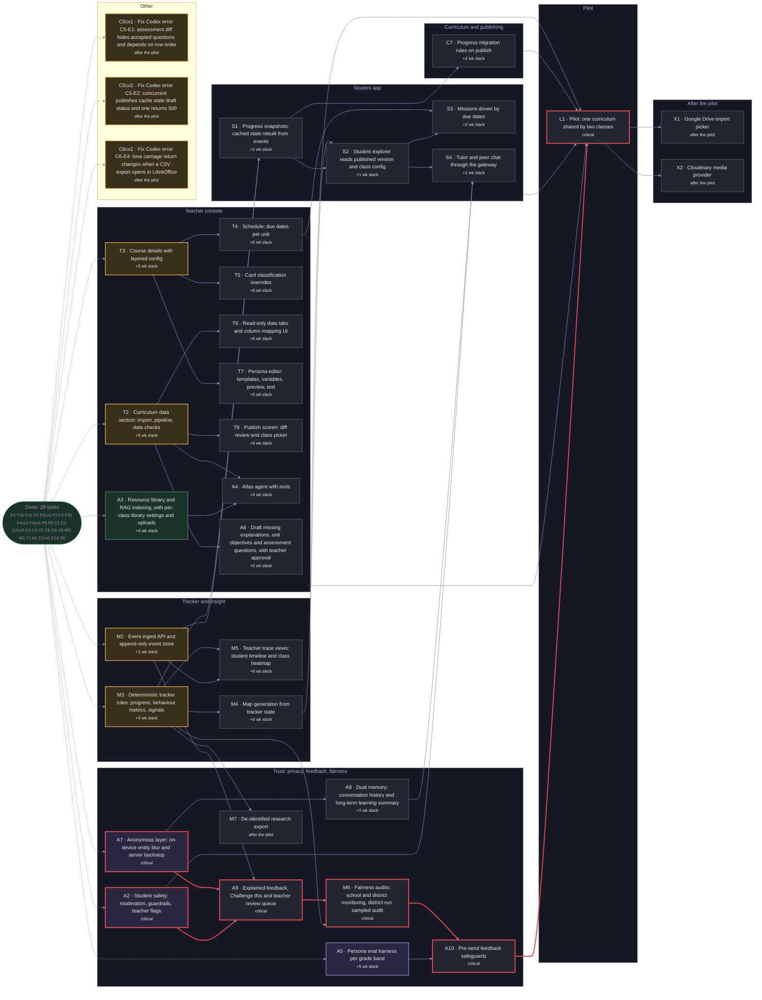

# Plan

<!-- Generated by `node scripts/plan.mjs` from docs/tasks.json. Do not edit by hand. -->

**28 of 62 done** · 1 ready · 3 in progress · 7 in review · 22 blocked · 1 need a spec

Critical path: F1 → F3 → F4 → F5 → A1 → A2 → A9 → M6 → A10 → L1 (up to 20 weeks)

## Ready to start

Pick from here. Claim with `node scripts/plan.mjs claim <ID> <agent>`. A task can be claimed only once its QA criteria exist.

| ID | Task | Phase | Size | QA |
|---|---|---|---|---|
| A3 | Resource library and RAG indexing, with per-class library settings and uploads | AI layer | 1–2 wks | [criteria](qa/A3.md) |

- **A3 done when:** Library uploads are chunked and embedded, and searchLibrary returns ranked passages. Per D11, a class can set each shared document to agent, tutor, both or off, and upload its own documents. Search for a class covers the shared library plus its uploads with its settings applied, and never returns another class's uploads. ClassConfig contracts gain the library settings. Vector search always filters by curriculum (and class for uploads) or uses hnsw.iterative_scan, so row-level security never returns fewer than k results (F4 QA finding 3)

## In progress

| ID | Task | Status | Owner | Since |
|---|---|---|---|---|
| A2 | Student safety: moderation, guardrails, teacher flags | In progress | agent-a2 | 2026-10-28 |
| A5 | Persona eval harness per grade band | In progress | agent-a5 | 2026-10-28 |
| A7 | Anonymous layer: on-device entity blur and server backstop | In progress | agent-a7 | 2026-10-28 |
| M2 | Event ingest API and append-only event store | Review | agent-m2b | 2026-10-27 |
| M3 | Deterministic tracker rules: progress, behaviour metrics, signals | Review | agent-m3 | 2026-10-24 |
| T2 | Curriculum data section: import, pipeline, data checks | Review | agent-t2 | 2026-10-24 |
| T3 | Course details with layered config | Review | agent-t3 | 2026-10-24 |
| C5cx1 | Fix Codex error C5-E1: assessment diff hides accepted questions and depends on row order | Review | agent-c5cx1 | 2026-10-27 |
| C5cx2 | Fix Codex error C5-E2: concurrent publishes cache stale draft status and one returns 500 | Review | agent-c5cx2 | 2026-10-27 |
| C6cx1 | Fix Codex error C6-E4: lone carriage return changes when a CSV export opens in LibreOffice | Review | agent-c6cx1 | 2026-10-27 |

## Blocked

| ID | Task | Waiting on |
|---|---|---|
| C7 | Progress migration rules on publish | S1 |
| M4 | Map generation from tracker state | M3 |
| M5 | Teacher trace views: student timeline and class heatmap | M2, M3 |
| T4 | Schedule: due dates per unit | T3 |
| T5 | Card classification overrides | T3 |
| T6 | Read-only data tabs and column mapping UI | T2 |
| T7 | Persona editor: templates, variables, preview, test | T3 |
| T8 | Publish screen: diff review and class picker | T2 |
| A4 | Atlas agent with tools | A3, T2 |
| A6 | Draft missing explanations, unit objectives and assessment questions, with teacher approval | T2 |
| S1 | Progress snapshots: cached state rebuilt from events | M2, M3 |
| S2 | Student explorer reads published version and class config | S1, M4 |
| S3 | Missions driven by due dates | S2, T4 |
| S4 | Tutor and peer chat through the gateway | S2, A2, A7, A8 |
| L1 | Pilot: one curriculum shared by two classes | T5, T6, T7, T8, A4, A5, S3, S4, C7, M5, A6, A7, A9, A10, M6 |
| X1 | Google Drive import picker | L1 |
| X2 | Cloudinary media provider | L1 |
| A8 | Dual memory: conversation history and long-term learning summary | A7 |
| A9 | Explained feedback, Challenge this and teacher review queue | A2, M2, A7 |
| A10 | Pre-send feedback safeguards | A9, A5, M6 |
| M6 | Fairness audits: school and district monitoring, district-run sampled audit | M3, A9 |
| M7 | De-identified research export | M3 |

## Needs a spec (placeholder)

Not claimable yet. A person writes the spec, then sets `placeholder` to false in docs/tasks.json.

| ID | Task | Waiting on |
|---|---|---|
| CXB | Codex suggestions waiting for task criteria (holding list, not claimable) | — |

## Done

- F1 Monorepo, CI, lint and test setup (agent-f1)
- F1b Fix F1 QA failures: tracker determinism lint, CI permissions (agent-f1b)
- F1c Close remaining tracker determinism gaps (from F1b QA) (agent-f1c)
- F2 Port Nocturne tokens and components to packages/ui (agent-f2)
- F2cx1 Fix Codex error F2-E1: placeholder text contrast (agent-f2cx1)
- F3 Domain types and zod contracts for import tabs and config (agent-f3)
- F4 Postgres schema and migrations (agent-f4)
- F4b Close F4 QA findings: event-key ledger isolation, class-scoped library settings (agent-f4b)
- F4cx3 Fix Codex error: idea-map typecheck and DB test broken by partial derived fixtures (F4-E3) (agent-f4cx3)
- F4cx1 Fix Codex errors F4-E1/F4-E2: temporary-table shadowing of event uniqueness and draft-pin guard (codex-f4cx1)
- F5 SSO sign-in, roles and org tenancy (agent-f5)
- F6 Privacy baseline: data inventory, retention, audit log (agent-f6)
- C1 CSV and XLSX import with column mapping (agent-c1)
- C2 Data checks engine (agent-c2)
- C2cx5 Fix Codex error C2-E5: store data-check issues in versions; gate publishing on data-check errors (codex-c2cx5)
- C3 Derivation: link ranking, layout, quiz generation (agent-c3)
- C4 Job queue and import job producing a draft version (agent-c4)
- C5 Draft vs published diff and Publish flow (agent-c5)
- C6 Exports: template, data-check and alignment reports (agent-c6)
- C8 Data-check and quiz quality fixes (from C2 and C3 QA) (agent-c8)
- C9 Apply D12 and D13: optional objectives and questions, one built-in persona list (codex-c9)
- MD Decision gate: education data mining and interaction tracing (user) (user)
- M1 Tracker event catalogue and schemas (agent-m1)
- T1 Teacher console shell, nav and save state (agent-t1)
- A1 AI gateway: server-side calls, prompt fill, rate limits (agent-a1)
- C1cx1 Fix C1-E1: bound CSV parser memory and reject duplicate ZIP tabs early (codex-c1cx1)
- F1d Close independent QA ambient-global tracker determinism gap (codex-f1d)
- S5 UDL 3.0 baseline for the student app (agent-s5)

## Dependency map

Open work only, grouped by what it delivers and ordered by priority. Critical path: A2 → A9 → M6 → A10 → L1 (about 20 weeks end to end). A rendered snapshot is in `docs/plan-map.png`.

Key: red border = critical path (no slack); green = ready; purple = in progress; amber = in review; grey = waiting. The number under each task is its slack: weeks it can slip before the pilot does. Done work is collapsed into one box, and arrows already implied by another path are left out of the drawing (tasks.json keeps every dependency).
