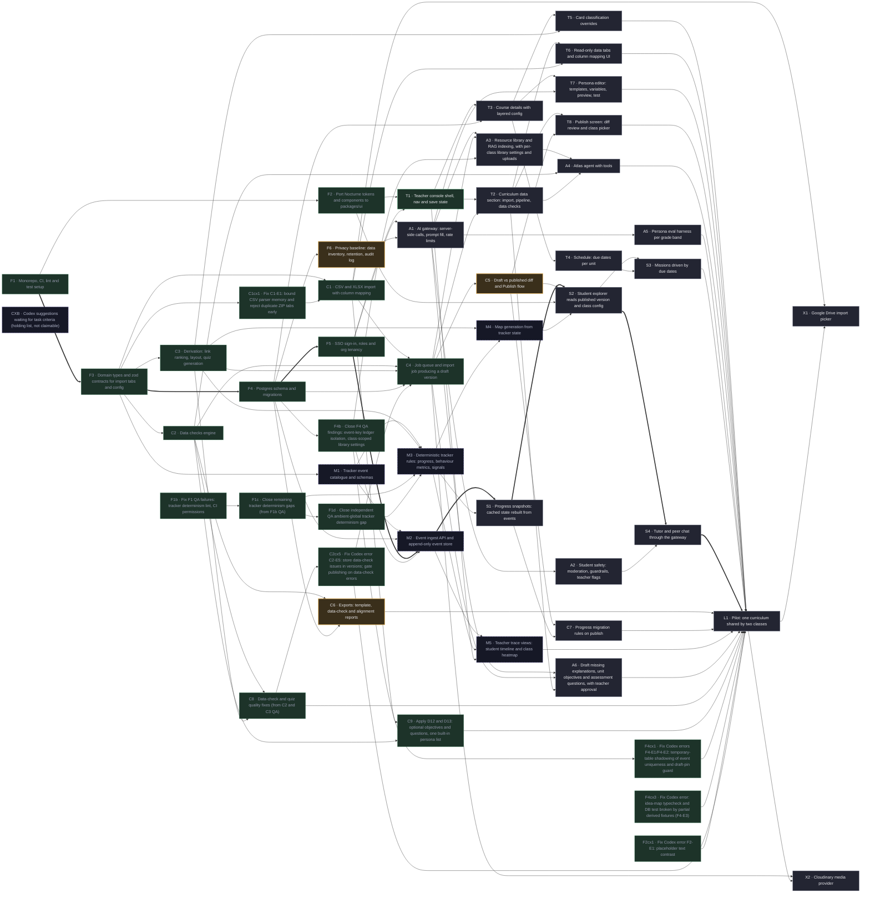

# Plan

<!-- Generated by `node scripts/plan.mjs` from docs/tasks.json. Do not edit by hand. -->

**20 of 51 done** · 1 ready · 0 in progress · 3 in review · 21 blocked · 6 need a spec

Critical path: F1 → F3 → F4 → F5 → M2 → S1 → S2 → S4 → L1 (up to 19 weeks)

## Ready to start

Pick from here. Claim with `node scripts/plan.mjs claim <ID> <agent>`. A task can be claimed only once its QA criteria exist.

| ID | Task | Phase | Size | QA |
|---|---|---|---|---|
| T1 | Teacher console shell, nav and save state | Teacher console | ≤1 wk | [criteria](qa/T1.md) |

- **T1 done when:** Teacher app shell with header, section nav and the Saving and Saved indicator, behind sign-in

## In progress

| ID | Task | Status | Owner | Since |
|---|---|---|---|---|
| F6 | Privacy baseline: data inventory, retention, audit log | Review | agent-f6 | 2026-10-23 |
| C5 | Draft vs published diff and Publish flow | Review | agent-c5 | 2026-10-23 |
| C6 | Exports: template, data-check and alignment reports | Review | agent-c6 | 2026-10-23 |

## Blocked

| ID | Task | Waiting on |
|---|---|---|
| C7 | Progress migration rules on publish | C5, S1 |
| T2 | Curriculum data section: import, pipeline, data checks | T1 |
| T3 | Course details with layered config | T1 |
| T4 | Schedule: due dates per unit | T3 |
| T5 | Card classification overrides | T3 |
| T6 | Read-only data tabs and column mapping UI | T2 |
| T7 | Persona editor: templates, variables, preview, test | T3, A1 |
| T8 | Publish screen: diff review and class picker | T2, C5 |
| A1 | AI gateway: server-side calls, prompt fill, rate limits | F6 |
| A2 | Student safety: moderation, guardrails, teacher flags | A1 |
| A3 | Resource library and RAG indexing, with per-class library settings and uploads | A1 |
| A4 | Atlas agent with tools | A3, T2 |
| A5 | Persona eval harness per grade band | A1 |
| A6 | Draft missing explanations, unit objectives and assessment questions, with teacher approval | A1, T2 |
| S1 | Progress snapshots: cached state rebuilt from events | M2, M3 |
| S2 | Student explorer reads published version and class config | S1, C5, M4 |
| S3 | Missions driven by due dates | S2, T4 |
| S4 | Tutor and peer chat through the gateway | S2, A2 |
| L1 | Pilot: one curriculum shared by two classes | T5, T6, T7, T8, A4, A5, S3, S4, C6, C7, M5, A6 |
| X1 | Google Drive import picker | L1 |
| X2 | Cloudinary media provider | L1 |

## Needs a spec (placeholder)

Not claimable yet. A person writes the spec, then sets `placeholder` to false in docs/tasks.json.

| ID | Task | Waiting on |
|---|---|---|
| CXB | Codex suggestions waiting for task criteria (holding list, not claimable) | — |
| M1 | Tracker event catalogue and schemas | — |
| M2 | Event ingest API and append-only event store | M1 |
| M3 | Deterministic tracker rules: progress, behaviour metrics, signals | M1 |
| M4 | Map generation from tracker state | M3 |
| M5 | Teacher trace views: student timeline and class heatmap | M2, M3, T1 |

## Done

- F1 Monorepo, CI, lint and test setup (agent-f1)
- F1b Fix F1 QA failures: tracker determinism lint, CI permissions (agent-f1b)
- F1c Close remaining tracker determinism gaps (from F1b QA) (agent-f1c)
- F2 Port Nocturne tokens and components to packages/ui (agent-f2)
- F2cx1 Fix Codex error F2-E1: placeholder text contrast (agent-f2cx1)
- F3 Domain types and zod contracts for import tabs and config (agent-f3)
- F4 Postgres schema and migrations (agent-f4)
- F4b Close F4 QA findings: event-key ledger isolation, class-scoped library settings (agent-f4b)
- F4cx3 Fix Codex error: idea-map typecheck and DB test broken by partial derived fixtures (F4-E3) (agent-f4cx3)
- F4cx1 Fix Codex errors F4-E1/F4-E2: temporary-table shadowing of event uniqueness and draft-pin guard (codex-f4cx1)
- F5 SSO sign-in, roles and org tenancy (agent-f5)
- C1 CSV and XLSX import with column mapping (agent-c1)
- C2 Data checks engine (agent-c2)
- C2cx5 Fix Codex error C2-E5: store data-check issues in versions; gate publishing on data-check errors (codex-c2cx5)
- C3 Derivation: link ranking, layout, quiz generation (agent-c3)
- C4 Job queue and import job producing a draft version (agent-c4)
- C8 Data-check and quiz quality fixes (from C2 and C3 QA) (agent-c8)
- C9 Apply D12 and D13: optional objectives and questions, one built-in persona list (codex-c9)
- C1cx1 Fix C1-E1: bound CSV parser memory and reject duplicate ZIP tabs early (codex-c1cx1)
- F1d Close independent QA ambient-global tracker determinism gap (codex-f1d)

## Dependency map

Arrows point from a task to the tasks it unblocks. Thick arrows are the critical path. The letter in each ID is its phase: F Foundations, C Curriculum pipeline, M Tracker & map generation, T Teacher console, A AI layer, S Student app hooks, L Launch, X Later.

Key: green = ready, purple = in progress, amber = review, green dashed = done, grey = blocked, purple dashed = needs a spec.
