# Plan

<!-- Generated by `node scripts/plan.mjs` from docs/tasks.json. Do not edit by hand. -->

**31 of 77 done** · 1 ready · 0 in progress · 14 in review · 29 blocked · 2 need a spec

Critical path: F1 → F3 → F4 → F5 → M2 → S1 → S2 → S7 → A12 → A13 → L1 (up to 22 weeks)

## Ready to start

Pick from here. Claim with `node scripts/plan.mjs claim <ID> <agent>`. A task can be claimed only once its QA criteria exist.

| ID | Task | Phase | Size | QA |
|---|---|---|---|---|
| X2 | Self-hosted video and media provider | Later | ≤1 wk | [criteria](qa/X2.md) |

- **X2 done when:** Per D42: media_url and demo_video_url resolve through a MediaProvider served from our own domain (no third-party players), with captions (D17); Cloudinary only as an optional backend behind it

## In progress

| ID | Task | Status | Owner | Since |
|---|---|---|---|---|
| M2 | Event ingest API and append-only event store | Review | agent-m2b | 2026-10-27 |
| M3 | Deterministic tracker rules: progress, behaviour metrics, signals | Review | agent-m3 | 2026-10-24 |
| T3 | Course details with layered config | Review | agent-t3 | 2026-10-24 |
| T6 | Read-only data tabs and column mapping UI | Review | agent-t6 | 2026-10-28 |
| T8 | Publish screen: diff review and class picker | Review | agent-t8 | 2026-10-28 |
| A2 | Student safety: moderation, guardrails, teacher flags | Review | agent-a2 | 2026-10-28 |
| A3 | Resource library and RAG indexing, with per-class library settings and uploads | Review | agent-a3 | 2026-10-28 |
| A5 | Persona eval harness per grade band | Review | agent-a5 | 2026-10-28 |
| A6 | Draft missing explanations, unit objectives and assessment questions, with teacher approval | Review | agent-a6 | 2026-10-28 |
| A7 | Anonymous layer: on-device entity blur and server backstop | Review | agent-a7 | 2026-10-28 |
| C5cx2 | Fix Codex error C5-E2: concurrent publishes cache stale draft status and one returns 500 | Review | agent-c5cx2 | 2026-10-27 |
| C6cx2 | Fix Codex error C6cx1-E1: CRLF inside a cell changes when an export opens in LibreOffice | Review | agent-c6cx2 | 2026-10-28 |
| C10 | Practice tab: spec, contracts, import, checks, diff and export | Review | agent-c10 | 2026-10-29 |
| C12 | Two-layer conceptual graph in the pack | Review | agent-c12 | 2026-10-29 |

## Blocked

| ID | Task | Waiting on |
|---|---|---|
| C7 | Progress migration rules on publish | S1 |
| M4 | Map generation from tracker state | M3 |
| M5 | Teacher trace views: student timeline and class heatmap | M2, M3 |
| T4 | Schedule: due dates per unit | T3 |
| T5 | Card classification overrides | T3 |
| T7 | Persona editor: templates, variables, preview, test | T3 |
| A4 | Atlas agent with tools | A3 |
| S1 | Progress snapshots: cached state rebuilt from events | M2, M3 |
| S2 | Student explorer reads published version and class config | S1, M4 |
| S3 | Teacher-assigned study track (missions) from due dates | S2, T4 |
| S4 | Tutor and peer chat through the gateway | S2, A2, A7, A8 |
| L1 | Pilot: one curriculum shared by two classes | T5, T6, T7, T8, A4, A5, S3, S4, C7, M5, A6, A7, A9, A10, M6, C5cx2, A11, C6cx2, C10, C11, C12, C13, T9, M8, M9, S6, S7, A12, A13, X2 |
| X1 | Google Drive import picker | L1 |
| A8 | Dual memory: conversation history and long-term learning summary | A7 |
| A9 | Explained feedback, Challenge this and teacher review queue | A2, M2, A7 |
| A10 | Pre-send feedback safeguards | A9, A5, M6 |
| M6 | Fairness audits: school and district monitoring, district-run sampled audit | M3, A9, M8 |
| M7 | De-identified research export | M3 |
| A11 | Grounded tutoring: sparring-partner mode when no verified source covers the question | A2, A3 |
| C11 | Kinematics sub-pilot fixture from vetted items | C10 |
| C13 | Vault standards graph | A3 |
| T9 | Prerequisite editing with district permissions and AI-proposed links | T6, C13 |
| M8 | Tracker rules v2: exercise levels, trace-back and diagnostics | M3, C10, C12 |
| M9 | Teacher diagnostic views with disclaimers and suggestions | M5, M8 |
| S6 | Idea page and exercise player | S2, C10, X2 |
| S7 | Student profile and onboarding | A2, A7, S2 |
| A12 | Dual-track study planner | S7, T4, A5 |
| A13 | Tutor study-plan tools | A12, S4 |
| S8 | Reminders and the notification hierarchy | A12 |

## Needs a spec (placeholder)

Not claimable yet. A person writes the spec, then sets `placeholder` to false in docs/tasks.json.

| ID | Task | Waiting on |
|---|---|---|
| CXB | Codex suggestions waiting for task criteria (holding list, not claimable) | — |
| A5b | Teacher-approved persona eval baselines | A5 |

## Done

- F1 Monorepo, CI, lint and test setup (agent-f1)
- F1b Fix F1 QA failures: tracker determinism lint, CI permissions (agent-f1b)
- F1c Close remaining tracker determinism gaps (from F1b QA) (agent-f1c)
- F2 Port Nocturne tokens and components to packages/ui (agent-f2)
- F2cx1 Fix Codex error F2-E1: placeholder text contrast (agent-f2cx1)
- F3 Domain types and zod contracts for import tabs and config (agent-f3)
- F4 Postgres schema and migrations (agent-f4)
- F4b Close F4 QA findings: event-key ledger isolation, class-scoped library settings (agent-f4b)
- F4cx3 Fix Codex error: idea-map typecheck and DB test broken by partial derived fixtures (F4-E3) (agent-f4cx3)
- F4cx1 Fix Codex errors F4-E1/F4-E2: temporary-table shadowing of event uniqueness and draft-pin guard (codex-f4cx1)
- F5 SSO sign-in, roles and org tenancy (agent-f5)
- F6 Privacy baseline: data inventory, retention, audit log (agent-f6)
- C1 CSV and XLSX import with column mapping (agent-c1)
- C2 Data checks engine (agent-c2)
- C2cx5 Fix Codex error C2-E5: store data-check issues in versions; gate publishing on data-check errors (codex-c2cx5)
- C3 Derivation: link ranking, layout, quiz generation (agent-c3)
- C4 Job queue and import job producing a draft version (agent-c4)
- C5 Draft vs published diff and Publish flow (agent-c5)
- C6 Exports: template, data-check and alignment reports (agent-c6)
- C8 Data-check and quiz quality fixes (from C2 and C3 QA) (agent-c8)
- C9 Apply D12 and D13: optional objectives and questions, one built-in persona list (codex-c9)
- MD Decision gate: education data mining and interaction tracing (user) (user)
- M1 Tracker event catalogue and schemas (agent-m1)
- T1 Teacher console shell, nav and save state (agent-t1)
- T2 Curriculum data section: import, pipeline, data checks (agent-t2)
- A1 AI gateway: server-side calls, prompt fill, rate limits (agent-a1)
- C1cx1 Fix C1-E1: bound CSV parser memory and reject duplicate ZIP tabs early (codex-c1cx1)
- F1d Close independent QA ambient-global tracker determinism gap (codex-f1d)
- S5 UDL 3.0 baseline for the student app (agent-s5)
- C5cx1 Fix Codex error C5-E1: assessment diff hides accepted questions and depends on row order (agent-c5cx1)
- C6cx1 Fix Codex error C6-E4: lone carriage return changes when a CSV export opens in LibreOffice (agent-c6cx1)

## Dependency map

Open work only, grouped by what it delivers and ordered by priority. Critical path: M2 → S1 → S2 → S7 → A12 → A13 → L1 (about 22 weeks end to end). A rendered snapshot is in `docs/plan-map.png`.

```mermaid
flowchart LR
  DONE(["Done: 31 tasks<br/><small>F1 F1b F1c F2 F2cx1 F3 F4 F4b F4cx3 F4cx1 F5 F6 C1 C2 C2cx5 C3 C4 C5 C6 C8 C9 MD M1 T1 T2 A1 C1cx1 F1d S5 C5cx1 C6cx1</small>"])
  subgraph trust["Trust: privacy, feedback, fairness"]
    direction LR
    A2["A2 · Student safety: moderation, guardrails, teacher flags<br/><small>+2 wk slack</small>"]
    A5["A5 · Persona eval harness per grade band<br/><small>+6 wk slack</small>"]
    A7["A7 · Anonymous layer: on-device entity blur and server backstop<br/><small>+2 wk slack</small>"]
    A8["A8 · Dual memory: conversation history and long-term learning summary<br/><small>+3 wk slack</small>"]
    A9["A9 · Explained feedback, Challenge this and teacher review queue<br/><small>+2 wk slack</small>"]
    A10["A10 · Pre-send feedback safeguards<br/><small>+2 wk slack</small>"]
    M6["M6 · Fairness audits: school and district monitoring, district-run sampled audit<br/><small>+2 wk slack</small>"]
    M7["M7 · De-identified research export<br/><small>after the pilot</small>"]
    A11["A11 · Grounded tutoring: sparring-partner mode when no verified source covers the question<br/><small>+7 wk slack</small>"]
    A12["A12 · Dual-track study planner<br/><small>critical</small>"]
    A13["A13 · Tutor study-plan tools<br/><small>critical</small>"]
  end
  subgraph tracker["Tracker and insight"]
    direction LR
    M2["M2 · Event ingest API and append-only event store<br/><small>critical</small>"]
    M3["M3 · Deterministic tracker rules: progress, behaviour metrics, signals<br/><small>+3 wk slack</small>"]
    M4["M4 · Map generation from tracker state<br/><small>+3 wk slack</small>"]
    M5["M5 · Teacher trace views: student timeline and class heatmap<br/><small>+7 wk slack</small>"]
    M8["M8 · Tracker rules v2: exercise levels, trace-back and diagnostics<br/><small>+7 wk slack</small>"]
    M9["M9 · Teacher diagnostic views with disclaimers and suggestions<br/><small>+7 wk slack</small>"]
  end
  subgraph curriculum["Curriculum and publishing"]
    direction LR
    C7["C7 · Progress migration rules on publish<br/><small>+6 wk slack</small>"]
    X2["X2 · Self-hosted video and media provider<br/><small>+8 wk slack</small>"]
    C5cx2["C5cx2 · Fix Codex error C5-E2: concurrent publishes cache stale draft status and one returns 500<br/><small>+19 wk slack</small>"]
    C6cx2["C6cx2 · Fix Codex error C6cx1-E1: CRLF inside a cell changes when an export opens in LibreOffice<br/><small>+18 wk slack</small>"]
    C10["C10 · Practice tab: spec, contracts, import, checks, diff and export<br/><small>+12 wk slack</small>"]
    C12["C12 · Two-layer conceptual graph in the pack<br/><small>+13 wk slack</small>"]
    C11["C11 · Kinematics sub-pilot fixture from vetted items<br/><small>+17 wk slack</small>"]
    C13["C13 · Vault standards graph<br/><small>+4 wk slack</small>"]
  end
  subgraph teacher["Teacher console"]
    direction LR
    T3["T3 · Course details with layered config<br/><small>+5 wk slack</small>"]
    T4["T4 · Schedule: due dates per unit<br/><small>+5 wk slack</small>"]
    T5["T5 · Card classification overrides<br/><small>+8 wk slack</small>"]
    T6["T6 · Read-only data tabs and column mapping UI<br/><small>+6 wk slack</small>"]
    T7["T7 · Persona editor: templates, variables, preview, test<br/><small>+7 wk slack</small>"]
    T8["T8 · Publish screen: diff review and class picker<br/><small>+8 wk slack</small>"]
    A3["A3 · Resource library and RAG indexing, with per-class library settings and uploads<br/><small>+4 wk slack</small>"]
    A4["A4 · Atlas agent with tools<br/><small>+6 wk slack</small>"]
    A6["A6 · Draft missing explanations, unit objectives and assessment questions, with teacher approval<br/><small>+7 wk slack</small>"]
    T9["T9 · Prerequisite editing with district permissions and AI-proposed links<br/><small>+4 wk slack</small>"]
  end
  subgraph student["Student app"]
    direction LR
    S1["S1 · Progress snapshots: cached state rebuilt from events<br/><small>critical</small>"]
    S2["S2 · Student explorer reads published version and class config<br/><small>critical</small>"]
    S3["S3 · Teacher-assigned study track (missions) from due dates<br/><small>+4 wk slack</small>"]
    S4["S4 · Tutor and peer chat through the gateway<br/><small>+2 wk slack</small>"]
    S6["S6 · Idea page and exercise player<br/><small>+3 wk slack</small>"]
    S7["S7 · Student profile and onboarding<br/><small>critical</small>"]
    S8["S8 · Reminders and the notification hierarchy<br/><small>after the pilot</small>"]
  end
  subgraph launch["Pilot"]
    direction LR
    L1["L1 · Pilot: one curriculum shared by two classes<br/><small>critical</small>"]
  end
  subgraph later["After the pilot"]
    direction LR
    X1["X1 · Google Drive import picker<br/><small>after the pilot</small>"]
  end
  DONE -.-> M2
  DONE -.-> M3
  DONE -.-> T3
  DONE -.-> T6
  DONE -.-> T8
  DONE -.-> A2
  DONE -.-> A3
  DONE -.-> A5
  DONE -.-> A6
  DONE -.-> X2
  DONE -.-> A7
  DONE -.-> C5cx2
  DONE -.-> C6cx2
  DONE -.-> C10
  DONE -.-> C12
  S1 --> C7
  M3 --> M4
  M2 --> M5
  M3 --> M5
  T3 --> T4
  T3 --> T5
  T3 --> T7
  A3 --> A4
  M2 ==> S1
  M3 --> S1
  S1 ==> S2
  M4 --> S2
  S2 --> S3
  T4 --> S3
  S2 --> S4
  A2 --> S4
  A8 --> S4
  A13 ==> L1
  L1 --> X1
  A7 --> A8
  A2 --> A9
  M2 --> A9
  A7 --> A9
  A5 --> A10
  M6 --> A10
  A9 --> M6
  M8 --> M6
  M3 --> M7
  A2 --> A11
  A3 --> A11
  C10 --> C11
  A3 --> C13
  T6 --> T9
  C13 --> T9
  M3 --> M8
  C10 --> M8
  C12 --> M8
  M5 --> M9
  M8 --> M9
  S2 --> S6
  C10 --> S6
  X2 --> S6
  A2 --> S7
  A7 --> S7
  S2 ==> S7
  S7 ==> A12
  T4 --> A12
  A5 --> A12
  A12 ==> A13
  S4 --> A13
  A12 --> S8
  teacher --> L1
  student --> L1
  curriculum --> L1
  trust --> L1
  tracker --> L1
  linkStyle default stroke:#8b8fa3,stroke-width:1.3px
  linkStyle 23,25,32,59,60,63 stroke:#e5484d,stroke-width:3px
  style trust fill:#161826,stroke:#3a3d52,color:#b2b6ca
  style tracker fill:#161826,stroke:#3a3d52,color:#b2b6ca
  style curriculum fill:#161826,stroke:#3a3d52,color:#b2b6ca
  style teacher fill:#161826,stroke:#3a3d52,color:#b2b6ca
  style student fill:#161826,stroke:#3a3d52,color:#b2b6ca
  style launch fill:#161826,stroke:#3a3d52,color:#b2b6ca
  style later fill:#161826,stroke:#3a3d52,color:#b2b6ca
  classDef todo fill:#232532,stroke:#75798c,color:#e9e9ed
  classDef ready fill:#1d3329,stroke:#6fcf97,color:#e9e9ed
  classDef doing fill:#2b2741,stroke:#9184d9,color:#e9e9ed,stroke-width:2px
  classDef review fill:#3a2f1b,stroke:#e6b45c,color:#e9e9ed,stroke-width:2px
  classDef spec fill:#161826,stroke:#968ae0,color:#b2b6ca,stroke-dasharray:6 4
  classDef done fill:#1d3329,stroke:#6fcf97,color:#9397ab,stroke-dasharray:3 3
  classDef crit stroke:#e5484d,stroke-width:3px
  class C7,M4,M5,T4,T5,T7,A4,S1,S2,S3,S4,L1,X1,A8,A9,A10,M6,M7,A11,C11,C13,T9,M8,M9,S6,S7,A12,A13,S8 todo
  class X2 ready
  class M2,M3,T3,T6,T8,A2,A3,A5,A6,A7,C5cx2,C6cx2,C10,C12 review
  class DONE done
  class M2,S1,S2,L1,S7,A12,A13 crit
```

Key: red border = critical path (no slack); green = ready; purple = in progress; amber = in review; grey = waiting. The number under each task is its slack: weeks it can slip before the pilot does. Done work is collapsed into one box, and arrows already implied by another path are left out of the drawing (tasks.json keeps every dependency).
